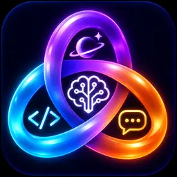
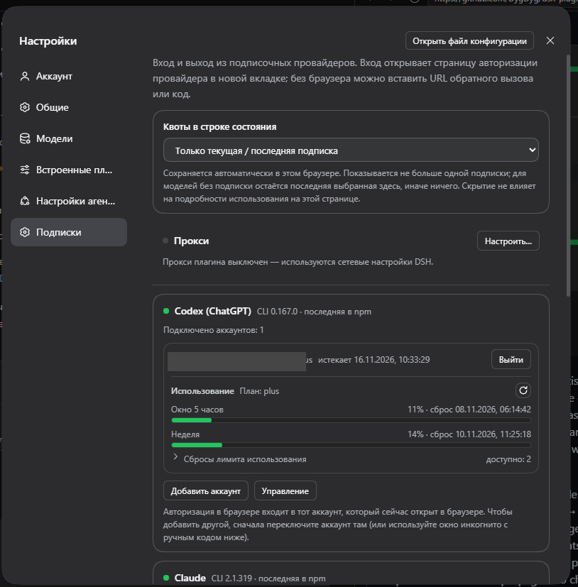
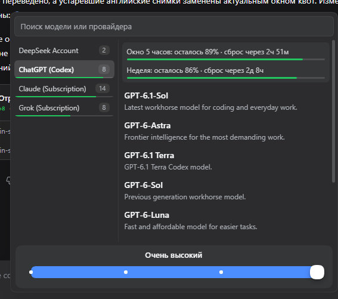
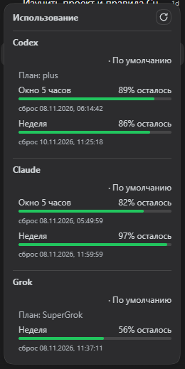
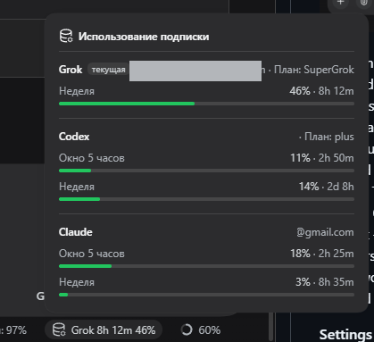
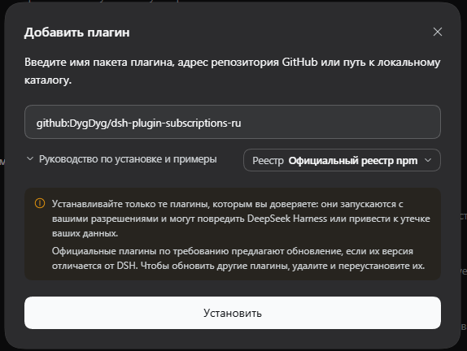

<p align="center">
  
</p>

# Grok Codex Claude

Русский интерфейс подписок **ChatGPT (Codex)**, **Claude**, **Grok**, **GitHub Copilot** и **Google Antigravity** для [DeepSeek Harness](https://github.com/deepseek-ai/deepseek-harness). Пакет публикуется как `dsh-plugin-subscriptions-ru`.

Ключ API не нужен. Codex, Grok и Antigravity входят через OAuth, Copilot — через код устройства GitHub, а Claude может использовать уже открытый сеанс Claude Code. Для Antigravity нужно заранее указать собственный OAuth-клиент. Токены хранятся в `~/.dsh/plugins/subscriptions/auth.json` и обновляются автоматически.

## Как выглядит

**Настройки → Подписки**: вход и выход для каждого провайдера, квоты и управление аккаунтами. Адреса на снимках скрыты.



Встроенный выбор модели показывает живые каталоги подключённых подписок, оставшиеся квоты и ползунок уровня рассуждений.



Значок на боковой панели открывает окно «Использование» со всеми подключёнными аккаунтами.



В строке состояния видна текущая подписка. Нажатие открывает квоты всех аккаунтов.



## Провайдеры

| Маршрут | Подписка | Модели |
|---|---|---|
| `codex` | ChatGPT Plus/Pro | живой каталог Codex |
| `claude` | Claude Pro/Max | модели, доступные в подписке |
| `grok` | X Premium | живой каталог xAI |
| `copilot` | GitHub Copilot | живой каталог Copilot |
| `antigravity` | Google Antigravity | живой каталог Antigravity |

В выборе модели появляются только подключённые провайдеры. Для моделей с уровнями рассуждений доступен ползунок. Уровни и описания берутся из каталога провайдера и не переводятся.

Окна квот показывают оставшийся процент и время сброса. Codex, Claude, Grok и Antigravity получают эти данные у своих сервисов. У Copilot отдельной точки для квот нет, поэтому блок использования у него не показывается.

Дополнительно доступны:

- поиск в интернете через Codex;
- поиск по X через Grok;
- генерация и редактирование изображений через ChatGPT или Grok;
- генерация видео через Grok.

Изображения сохраняются в `~/.dsh/plugins/subscriptions/images/`, видео — в `~/.dsh/plugins/subscriptions/videos/`.

## Установка

Нужен DeepSeek Harness `0.2.0-rc.2` или новее. Версия `0.1.x` не поддерживается.

### Через меню

1. Откройте **Настройки → Плагины → Добавить плагин**.
2. Вставьте адрес:

```text
github:DygDyg/dsh-plugin-subscriptions-ru
```

3. Оставьте **Официальный реестр npm** и нажмите **Установить**.


4. Если появится запрос на сборку, разрешите её и повторите установку.
5. Перезапустите DeepSeek Harness.
6. Откройте **Настройки → Подписки** и войдите в свои аккаунты.

Имя пакета вводить не нужно: плагин устанавливается из GitHub, а не из npm.

### Через командную строку

```sh
dsh plugin --profile desktop add github:DygDyg/dsh-plugin-subscriptions-ru
```

Если профиль называется иначе, замените `desktop` его именем. После установки перезапустите DeepSeek Harness.

## Использование

1. Откройте DSH и перейдите в **Настройки → Подписки**.
2. Нажмите **Войти** у нужного провайдера. Для Claude можно импортировать уже открытый сеанс Claude Code. Для Copilot введите показанный код на `github.com/login/device`.
3. В сеансе откройте выбор модели и выберите модель подключённой подписки.
4. Уровень рассуждений меняется ползунком в том же меню.

Без входа провайдер не появляется в списке моделей. Остальная работа DSH при этом не нарушается.

К одной подписке можно добавить несколько аккаунтов. Браузер входит в тот аккаунт, который сейчас в нём открыт; для другого аккаунта сначала переключите его или используйте окно инкогнито. Аккаунт по умолчанию отмечен звёздочкой. При нескольких аккаунтах запросы могут автоматически переходить на доступный аккаунт того же провайдера.

В **Настройки → Подписки → Управление** можно изменить видимые модели, контекст, уровень рассуждений по умолчанию и инструменты провайдера. Изменения вступают в силу после сохранения. Скрытая модель остаётся доступной уже открытым сеансам.

## Настройка

```yaml
- id: llm-subscriptions
  name: dsh-plugin-subscriptions-ru
  config:
    providers: [codex, claude, grok, copilot, antigravity]
    antigravity:
      clientId: ваш-client-id
```

Для Antigravity можно вместо настройки задать `ANTIGRAVITY_CLIENT_ID`. Секрет клиента необязателен и никогда не подставляется из другого источника. Собственный OAuth-клиент в пакет не входит.

Прокси настраивается в **Настройки → Подписки → Прокси**. Если он выключен, используются сетевые настройки DSH. Поддерживаются HTTP-прокси; SOCKS не поддерживается.

## Обновление

Удалите плагин в **Настройки → Плагины** и установите его заново тем же адресом GitHub. Затем перезапустите DeepSeek Harness.

Через командную строку повторите команду установки: она заново загрузит и соберёт источники.

## Разработка

```sh
pnpm install
pnpm build
pnpm test
```

Исходная английская сборка: [dsh-plugin-subscriptions](https://github.com/V1ki/dsh-plugin-subscriptions).
